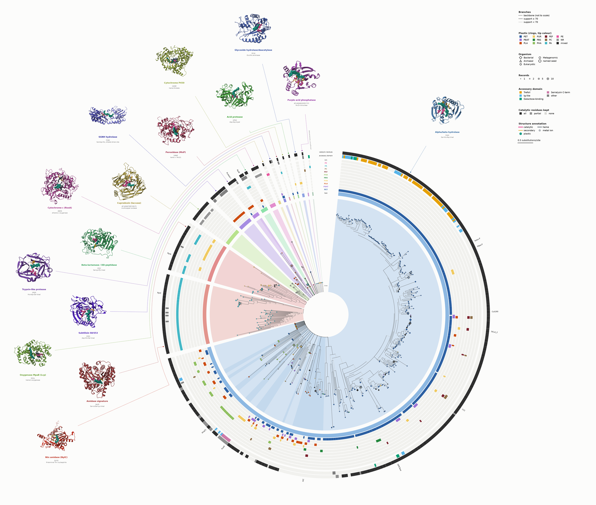
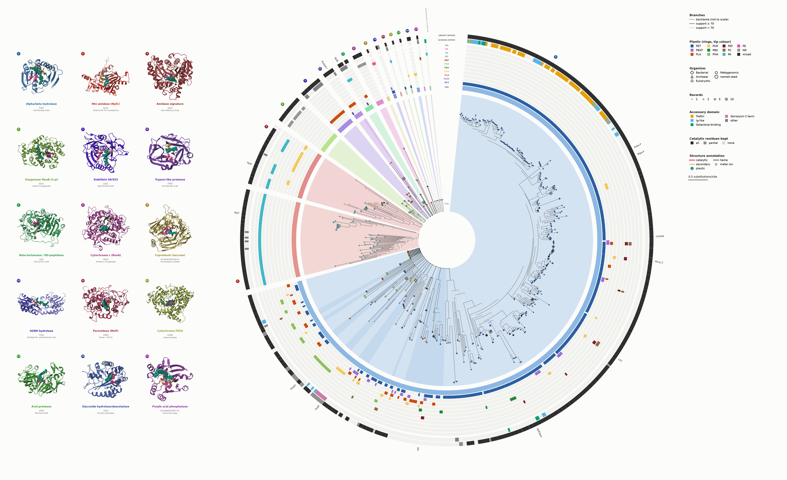
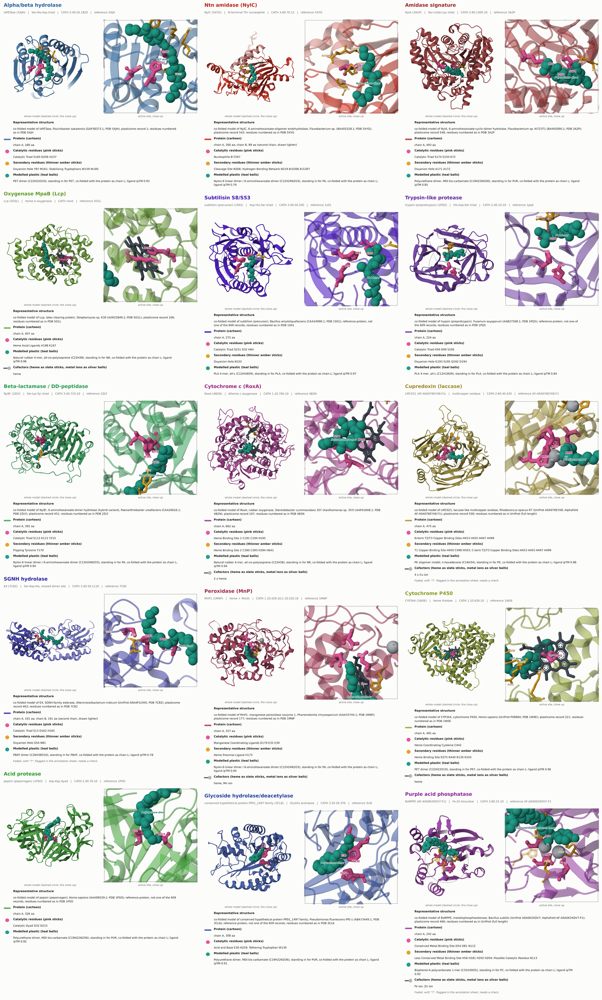
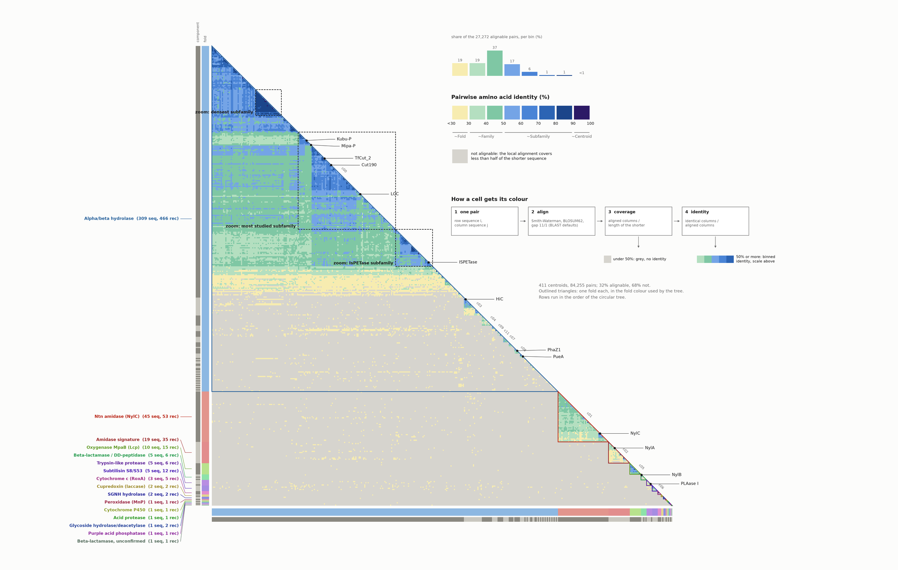
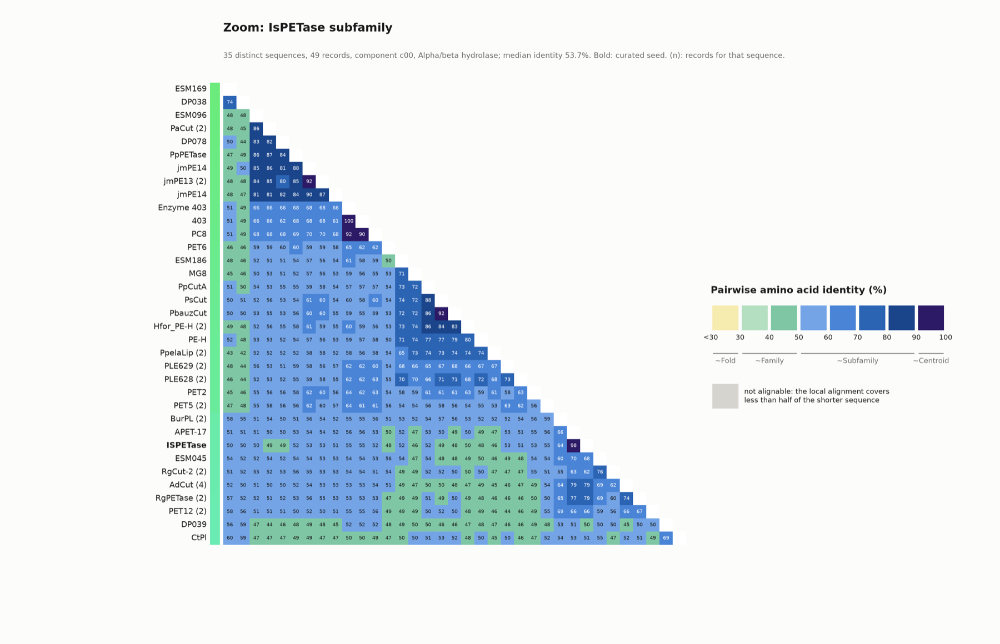
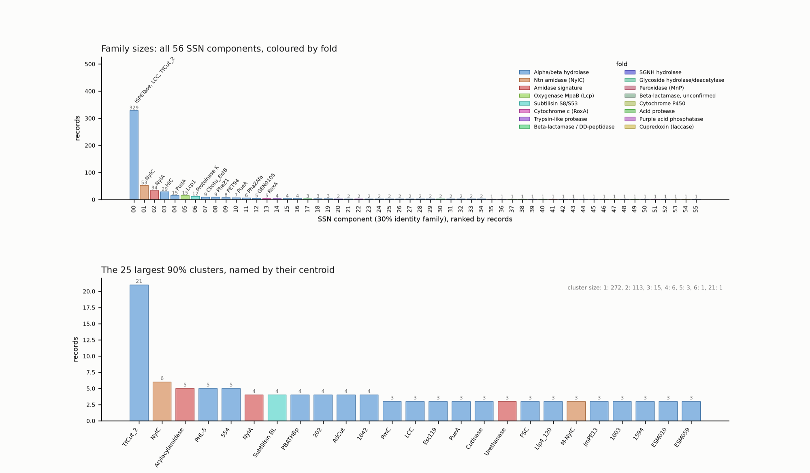
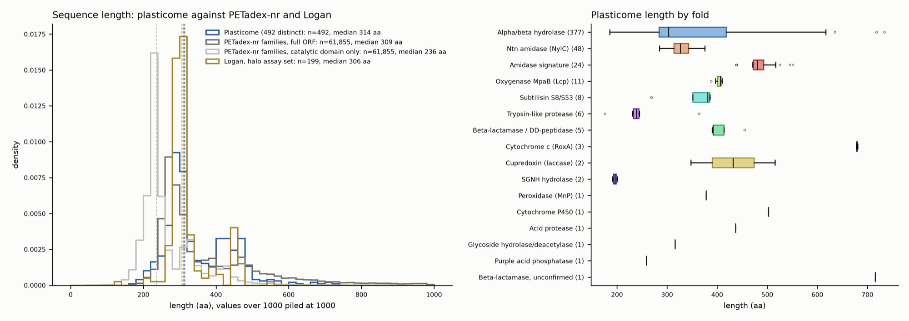
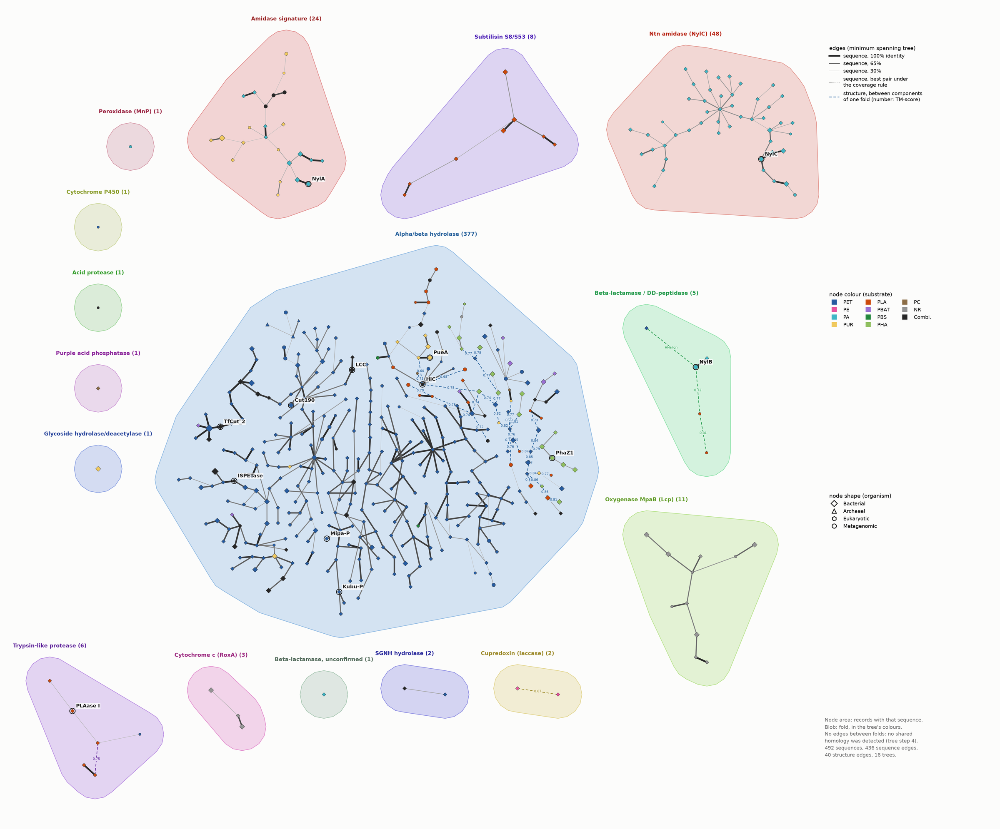
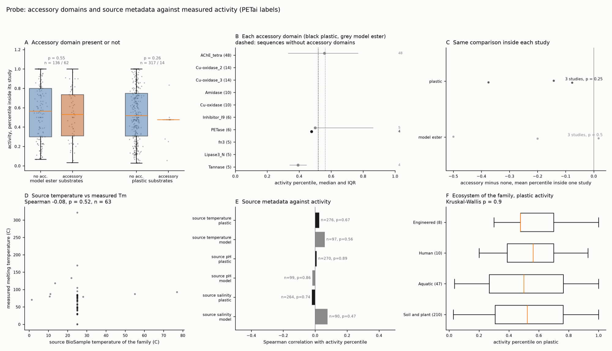

# Figure feedback, overnight run of 2026-10-27

This covers the feedback on the tree, heatmap and graph panels. Every item is
listed below with what was done and where the output is. Nothing that existed
before was overwritten. The new work is in new numbered scripts and new output
files, and the hand-edited pie in `tree/figure-pie-hand-edited/` and
`tree/dennis-build/` was not touched.

Previews (downsized PNGs) are in `previews/`. The full-resolution SVG, PDF and
PNG files are at the paths given in each section.

## For you: structures still to derive

The ring tree now shows a structure only for folds that have one in
`plasticome-structure-annotations/good_folds/`. One fold has none, so its
structure slot was removed and only its name is printed at the rim of its
slice:

| | |
|---|---|
| Fold | Beta-lactamase / DD-peptidase (CATH 3.40.710.10), "unconfirmed" |
| Sequence | PA4-degrading enzyme, GenBank BEG79545, *Pseudoalteromonas* sp., 716 aa |
| In the union | record 219, component c46, PA, no UniProt or PDB accession, `has_structure` no |
| Accessory domain | galactose-binding-like (CATH 2.60.120.260) |
| Paper | 10.1016/j.polymdegradstab.2023.110446 |

Why it is "unconfirmed": `04_homology.py` confirms a component's place in a
fold with a TM-score of 0.5 or more to a fold mate, or an HHalign probability
of 90 or more. c46 had no structure, so TM-align could not run, and its
HHalign score to the other beta-lactamase components fell short.

How to derive it, if you want to:

1. Look for an existing model first. The union has no UniProt accession for
   it. Map BEG79545 to UniProt through UniParc (sequence match). If it has an
   AlphaFold DB entry, use that.
2. Otherwise, co-fold it the way the other 15 in `good_folds/` were made, with
   a PA4 (nylon-4) oligomer as chain L. For example, a 4-aminobutanoate dimer,
   rather than the nylon-6 dimer used for the DD-peptidase model.
3. TM-align its catalytic domain against
   `good_folds/04_DD_peptidase_beta_lactamase_model_0.pdb`. At 0.5 or more,
   c46 is a confirmed beta-lactamase member and joins that slice, and the
   "unconfirmed" fold goes away. Locate its catalytic residues (the S-x-x-K,
   S-x-N and K-T-G motifs of the family) from the structural alignment.
4. Add a row for it to `petadex_domain_summary.csv`, then rerun steps 04, 05,
   17 and 18 (for step 04, the model has to be listed in
   `work/structures.tsv`).

It is also the one "no annotated structure" cell in the catalytic-residue
ring.

## Decisions to check first

These are places where the feedback could be read more than one way, with the
reading that was built.

1. **"Fix the ordering of the components."** Folds run clockwise from 12
   o'clock, largest first, and inside every tree the larger child is drawn
   first. The heatmap reads the same order from `ring_order.tsv`.
2. **"Faint rainbow for everything to enable tracking."** Built, then removed
   at your request with its position ring and the heatmap's position strips.
   `--rainbow` still draws it.
3. **"Full 609 dataset, or size the circles."** Both. The default tree has
   492 distinct sequences standing for all 609 records, tip area by records.
   The centroid tree (411 tips) sizes each tip by its 90 percent cluster.
4. **"Known substrate vs mutated substrate (lipid vs plastic)."** Still open.
   A per-fold "native substrate" line was drafted, then removed because it is
   not verified (it is kept, undrawn, as `NATIVE` in `tree/folds.py`).
5. **Colours for the six single-sequence folds.** Each has its own hue in the
   gaps of the ten atlas hues, defined in `tree/folds.py` and used by every
   figure. Three were moved after review: Ntn amidase to a vivid red-orange,
   subtilisin to blue-violet, and the glycoside hydrolase to cobalt (it was
   CIELAB distance 12 from the aqua of the modelled plastic, now 70).

## 1. Circular tree

`tree/18_ring_tree.py` writes `tree/runs/all-sequences/results/figures/plain/tree-circle.*`
(default) and `tree/runs/centroids/results/figure_ring.*`. Since 2026-10-28 the default is the panel layout (below, with larger structures
and no leaders); `--leaders` writes the earlier circle as `figure_ring_leaders.*`
and `--vertical` the rectangular tree as `figure_vertical.*`.



How it stands:

- **Slices** take the share of the circle of the records they stand for. All
  16 folds are their own slice.
- **Branches.** Dashed backbone (structure based, not to scale), solid branch
  (to scale, ensemble support 70 or more), pale branch (support under 70). No
  support numbers are printed. The backbone keeps only branches with UFBoot
  95 or more.
- **Rings**, inside out: fold, one ring per plastic (PET, PBAT, PLA, PUR, PBS,
  PHA, PEF, PC, PA, PE, NR), accessory domain, catalytic residues kept. Ring
  names sit in the gap at 12 o'clock.
- **Tips**: shape for organism, colour for plastic, area for records. The 13
  seeds, IsPETase among them, are ringed and named.
- **Structures** sit in two staggered rows in slice order. Each leader runs out
  from its slice to its own lane, along it, then to the structure, and is
  drawn in the fold's colour. A layout check on every build counts leader
  crossings, leaders through text or pictures, and text overlaps; it is zero
  for both trees and the panel version. The unconfirmed beta-lactamase has no
  structure and only small grey text at the edge of its slice.
- **Legend**: Branches, Plastic, Organism, Records, Accessory domain,
  Catalytic residues kept (all, partial, none; empty cell for not assessed),
  Structure annotation, scale bar.

**Panel version** (`--panel`). The structures sit in a 3 by 5 grid left of the
ring, in clockwise order. A numbered badge in the fold's colour on each slice
and on its picture replaces the leaders. It has its own layout file
(`ring_layout.<set>.panel.json`) and editor (`figure_ring_panel.html`).



**Catalytic residues ring.** Whether each sequence keeps the catalytic residues
of its fold's annotated model:

- By sequence when the sequence is at least 25 percent identical to the model
  (identical residues over the shorter of the two).
- Otherwise by structure (`tree/catalytic_struct.py`): the sequence's SSN
  family representative is superposed on the model with Foldseek in TM-align
  mode (TM 0.5 or more), and the result is mapped to the sequence through the
  family (25 percent identity or more to the representative).
- On both routes a residue counts as kept within two positions of where it
  maps, to allow for a slip at a loop.

| | all kept | partial | none | not assessed | no structure |
|---|---:|---:|---:|---:|---:|
| all sequences (492) | 437 | 16 | 1 | 37 | 1 |
| centroids (411) | 364 | 14 | 0 | 32 | 1 |

The 37 not assessed are 18 from one family whose representative superposes at
TM 0.491 (all 18 keep all three residues if the cutoff is lowered to 0.49), 10
too far from their own family representative, 8 with a catalytic residue in a
loop the superposition left unpaired, and 1 with no representative structure.
`catalytic_conservation.tsv` next to each figure records the method and scores
for every sequence.

An earlier version of this ring had 38 to 39 "none kept". Nearly all of those
were an artefact: the identity was measured over the aligned pairs only, so a
sequence that overlapped the model by a few residues at one end scored as 40
to 100 percent identical and went down the sequence route. EstB, for example,
paired with the model at a single residue.

**Editor.** `figure_ring.html` opens from disk and draws the same figure as SVG.
You can:

- drag a structure, and its leader follows
- set a structure's size, or switch it between the full view and the site zoom
- double click any label to reword it
- drag the legends
- switch layers on and off
- hover a structure to see what is in it
- export SVG (with named layers for Inkscape), PNG, or the layout

**Export layout** saves `ring_layout.all.json` (or `.centroids.json`). Put it
in `tree/` and the next run uses it, so the PDF gets the same placement and
wording.

## 2. Mechanism cards

`tree/17_mechanism_cards.py` writes `tree/runs/mechanisms/`: one card per fold
(`cards/`), the structure alone (`full/`, used by the tree), the active site
alone (`zoom/`), and all 15 on one sheet.



- **Renderer.** Mol\* 5.6.1 in the style of the iGEM wiki viewer, run headless
  in Chrome (`tree/molstar/`), orthographic camera, 3600 px renders. Cards are
  450 dpi; the tree embeds structures at 600 dpi.
- **What is drawn**, one representation per kind of thing:
  - protein: cartoon in the fold's colour, a second chain lighter
  - catalytic residues: pink sticks, bold labels
  - secondary residues: thinner amber sticks
  - modelled plastic: teal balls at 70 percent of van der Waals size
  - heme: dark slate sticks
  - metal ions: silver balls
- **Viewing angle.** Of 800 directions, the camera takes the one where the
  fewest mechanism atoms sit behind the backbone (catalytic side chains
  weighted 3, secondary residues and plastic 1, cofactors 0.5), with a pull
  toward the mechanism's centre. Cartoon still in front of the site is cut
  away. The full view's frame is centred near the mechanism, moving toward the
  middle of the protein as far as keeps the site within 20 percent of the half
  width, so an off-centre site no longer leaves the protein small.
- **Numbering.** Labels use the numbering of each fold's reference structure,
  as the literature does: IsPETase S160, D206, H237 (the model's own numbers
  were S128, D174, H205). Each model residue is mapped to its full-length
  source protein, then to the author number of the reference PDB entry
  (`tree/reference_pdb/`, from RCSB). The two AlphaFold references use
  UniProt numbering. `sites.tsv` keeps the model number beside it. A blanket
  full-length numbering would be wrong for subtilisin (S221), pepsin (D32,
  D215), MnP and trypsin, whose literature numbers count from the mature chain.
- **Card key.** Representative structure (with the numbering used), protein
  chains, catalytic and secondary residues by role, the modelled plastic
  (name, formula, what it stands in for, ipTM), cofactors.
- **Representative structures.** Named on every card, in the tree and in the
  editor; source in `REPRESENTATIVE` in `tree/folds.py`. All 15 models were
  aligned to their source proteins (`tree/representatives.faa`). Two
  accessions in the annotation sheet are wrong (the DD-peptidase model is
  NylB', the P450 is CYP3A4), and expression tags were trimmed from IsPETase
  and Lcp. Four models are reference proteins from outside the 609 records:
  trypsin from *Fusarium oxysporum* (1PQ5), subtilisin BPN' (1S01), human
  pepsin (1PSO) and a *P. fluorescens* Pf0-1 hypothetical protein (3CL6).

**Annotation sheet.** Every residue was checked against its model. Proposed
corrections to `petadex_domain_summary.csv` are in
`annotation_sheet_corrections.tsv` here; the sheet itself was not edited:

- the two wrong accessions
- SGNH oxyanion glycine: G51, not G55 (fold 55 is Ala; G51's backbone N is
  4.7 A from the catalytic Ser OG)
- cupredoxin C457 and phosphatase H39: the "CORRECTED?" flags can go (C457
  binds the T1 copper in the model; H39 completes the DxH motif)
- cupredoxin: the "N-term" T2/T3 histidines listed are the C-terminal ones
  (H412, H414, H456, H458) repeated; the model's N-terminal copper ligands are
  H83, H85, H125, H127

Until the sheet changes, the three flagged residues are drawn faded with a "?".

## 3. Heatmap

`plasticome-heatmap/07_heatmap_v2.py` writes everything to
`plasticome-heatmap/out_v2/`.



| Feedback item | What was done |
|---|---|
| Keep the one heatmap; make the non-alignable area clear instead of same and other fold | One grey for "not alignable" and nothing else. The fold is no longer encoded in the grey |
| Show the clustering of the folds | Each fold's block on the diagonal is outlined in its fold colour, with a fold strip on both margins |
| Fold colours consistent | Same `folds.py` colours as the tree, MST and length plot |
| Not enough legend labels; how the shading works is not obvious | Labelled identity scale with tier brackets, the not-alignable swatch spelled out, and a four-step "how a cell gets its colour" diagram (pair, Smith-Waterman, coverage check, identity bin) |
| More labels on the heatmap | Every fold with sequence and record counts, every SSN component of 5 or more, all seeds, and dashed boxes for the zooms |
| Histogram of the largest clusters | `figure_cluster_sizes`: all 56 components ranked by records and coloured by fold, plus the 25 largest 90 percent clusters by name |
| Zoom into the best studied or densest cluster, possibly IsPETase | Three zooms on all distinct sequences (not only centroids), with every row named and every cell numbered when the group is small |

The three zooms, chosen by rule, not by eye:

| Zoom | Rule | Sequences | Records | Median identity |
|---|---|---:|---:|---:|
| IsPETase | the 50 percent subfamily of component 0 that holds IsPETase | 35 | 49 | 53.7 |
| most studied | the 50 percent subfamily with the most records | 91 | 113 | 57.4 |
| densest | the 70 percent subfamily of 20 or more with the highest median identity | 38 | 38 | 85.5 |

The densest group is a set of metagenomic TEP and numbered sequences, not a
named enzyme family. It is dense because it was sampled densely, which may be
worth a sentence.





Counts on the 411 centroids are unchanged from step 3: 84,255 pairs, 27,272
(32 percent) alignable, 56,983 (68 percent) not alignable.

## 4. Length distributions

`out_v2/figure_lengths.*` and `length_summary.tsv`.



| Set | n | Median | 5th to 95th percentile |
|---|---:|---:|---|
| Plasticome, distinct sequences | 492 | 314 | 231 to 493 |
| PETadex-nr families, full ORF | 61,855 | 309 | 246 to 678 |
| PETadex-nr families, catalytic domain only | 61,855 | 236 | 189 to 428 |
| Logan, halo assay set | 199 | 306 | 272 to 457 |

The plasticome is the same length as nr proteins in the PETadex families
(median 314 against 309). nr has a longer tail of multidomain proteins. The
domain-only line is there because the atlas family representative is a
trimmed catalytic domain. Using it would make plasticome look 80 residues
longer than nr, which is an artefact of the trimming. My first draft made that
mistake and it is corrected here.

**Logan is not properly covered.** The only Logan protein sequences on this
machine are the 199 genes sent to the halo assay, which were chosen, not
drawn at random. A real Logan distribution needs the PETadex database, which
is the same credentials blocker as the UMAP switch.

## 5. Graph as a minimum spanning tree

`ssn/build_mst.py` writes `ssn/out/figure_mst.*` and `mst_edges.tsv`.



The nodes are the 492 distinct sequences, with the same encodings as the tree
(area is records). Inside each SSN family, the edges are the minimum spanning
tree on pairwise identity: solid, darker and thicker at higher identity.
Inside a fold, the families are joined by the minimum spanning tree on
TM-score between their representative structures. These are dashed in the
fold colour and labelled with the TM-score. Folds are not joined, since step 4
found no homology between them, so the figure is a forest of 16 trees and says
so. That gives 436 sequence edges and 40 structure edges. Every family was
connected under the 50 percent coverage rule, so no fallback edges were
needed.

## 6. Activity probe

`activity-probe/01_scan_pfam.py` (Pfam scan, runs in the
petadex-adjacency-landscape venv) and `02_probe.py` write
`activity-probe/out/`.



The input is the PETai labels, 13,092 measurements on 1,219 sequences from 696
references. Each measurement became a percentile inside its own study group
(reference, variable, substrate, unit; groups of 5 or more), and only
activity-type variables were kept. Accessory domains come from a Pfam scan of
the measured sequences themselves. Source metadata is at the level of the
atlas family each sequence maps to.

**Result: no signal anywhere, and the probe is underpowered.**

- Accessory domain against none: plastic substrates median 0.48 against 0.52
  (n = 14 against 317, p = 0.27); model esters 0.53 against 0.56 (p = 0.55).
- Only 3 studies measured sequences both with and without accessory domains,
  too few for the within-study test.
- Source temperature, pH and salinity against activity: every Spearman
  correlation is between -0.02 and 0.08, with every p over 0.4.
- Ecosystem against plastic activity: Kruskal-Wallis p = 0.9.

What limits it:

- 680 of the 1,219 sequences have a PETase catalytic domain, mostly IsPETase
  variant libraries.
- Only 14 plastic-scored sequences carry an accessory domain.
- The "accessory" list includes AChE_tetra, the tetramerisation tail of
  acetylcholinesterases, which is not a binding module.
- Source temperature is mostly a default of 25 C.
- The Tm column has values up to 320, which are not melting temperatures and
  should be cleaned upstream.

This is a first pass, worth showing only as "the simple probe finds nothing".
A fair test needs a family-diverse activity set, such as the halo assay on
more than the 5 accessory-domain genes it has now.

## Not done, and why

- **"Deep sequence representation, for training dataset."** This reads as a
  framing note for the story rather than a figure task. I did not act on it.
- **"Make sure everything is necessary"** and **"Cells by the Numbers style."**
  These are editorial passes over the assembled figure. My suggestion: once
  you have picked between the all-sequences and centroid trees, drop the other
  one, and keep only one of the cluster-size panel and the MST, since both
  show family sizes.

## Rerunning

```
PY=/opt/homebrew/Caskroom/miniconda/base/envs/plasticome/bin/python
cd tree
$PY 17_mechanism_cards.py                # Mol* renders, about 3 min; --no-render reuses them
$PY 18_ring_tree.py                                         # all 609 records
PLASTICOME_TREE_SET=centroids $PY 18_ring_tree.py           # 411 centroids
$PY 18_ring_tree.py --vertical                              # rectangular tree
$PY 18_ring_tree.py --leaders                               # the earlier circle, with leaders
cd ../plasticome-heatmap && $PY 07_heatmap_v2.py            # needs both ring runs
cd ../ssn && $PY build_mst.py
cd ../activity-probe
~/Documents/projects/petadex-adjacency-landscape/.venv/bin/python 01_scan_pfam.py
$PY 02_probe.py
```

Everything ran on the laptop in under a minute per script. Nothing needed the
cluster.

New files: `tree/folds.py`, `tree/17_mechanism_cards.py`, `tree/molstar/`
(Mol\* renderer; `npm install` there pulls playwright-core),
`tree/18_ring_tree.py`, `tree/ring_scene.py`, `tree/templates/ring_editor.html`, `plasticome-heatmap/07_heatmap_v2.py`,
`ssn/build_mst.py`, `activity-probe/`, and this folder.
